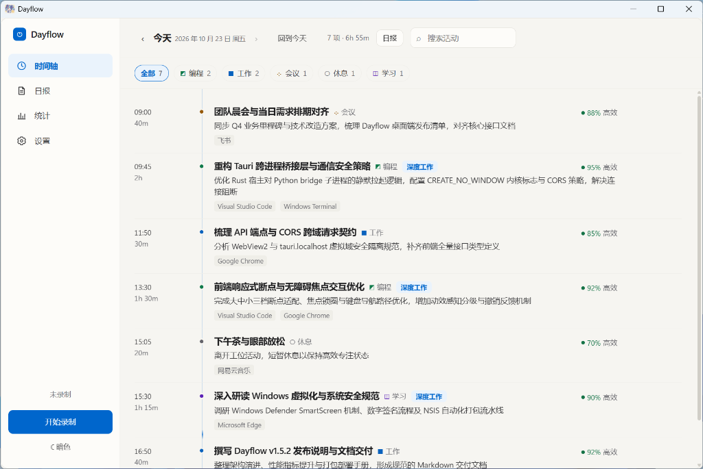
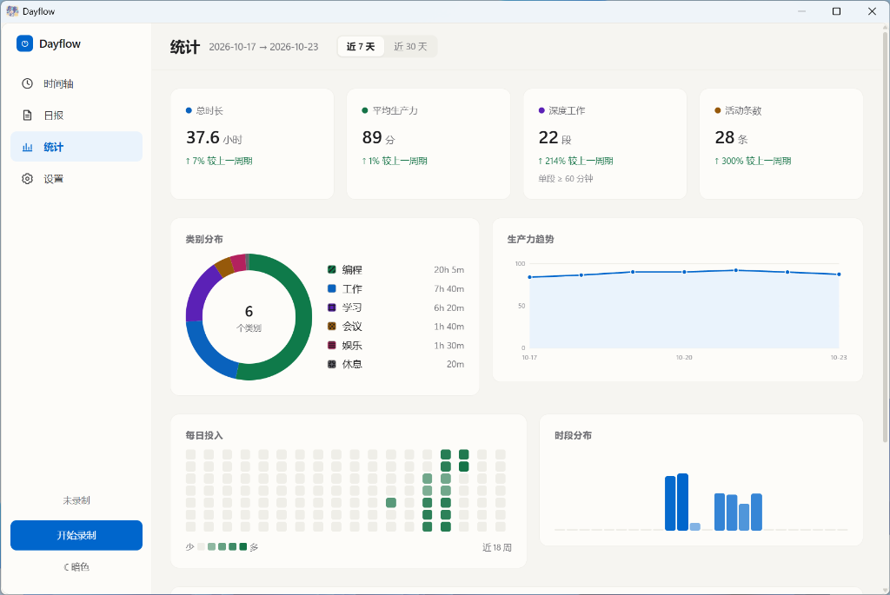
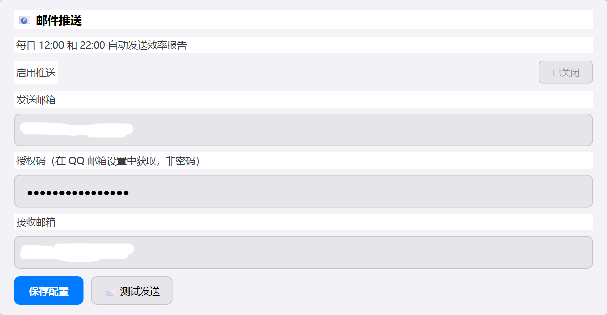
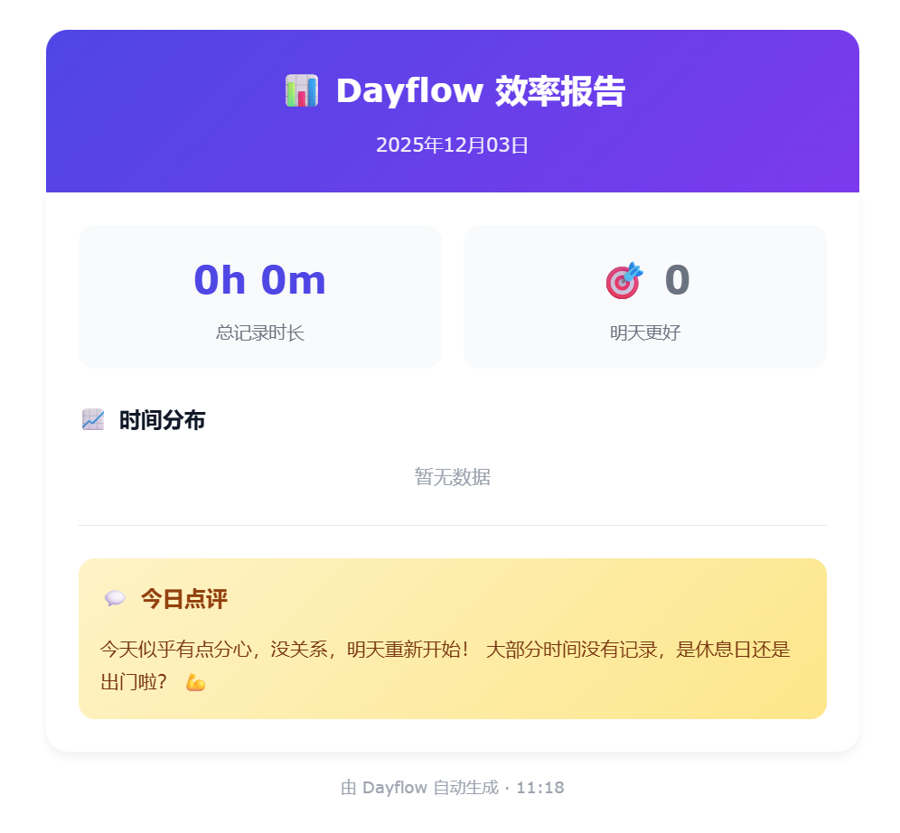
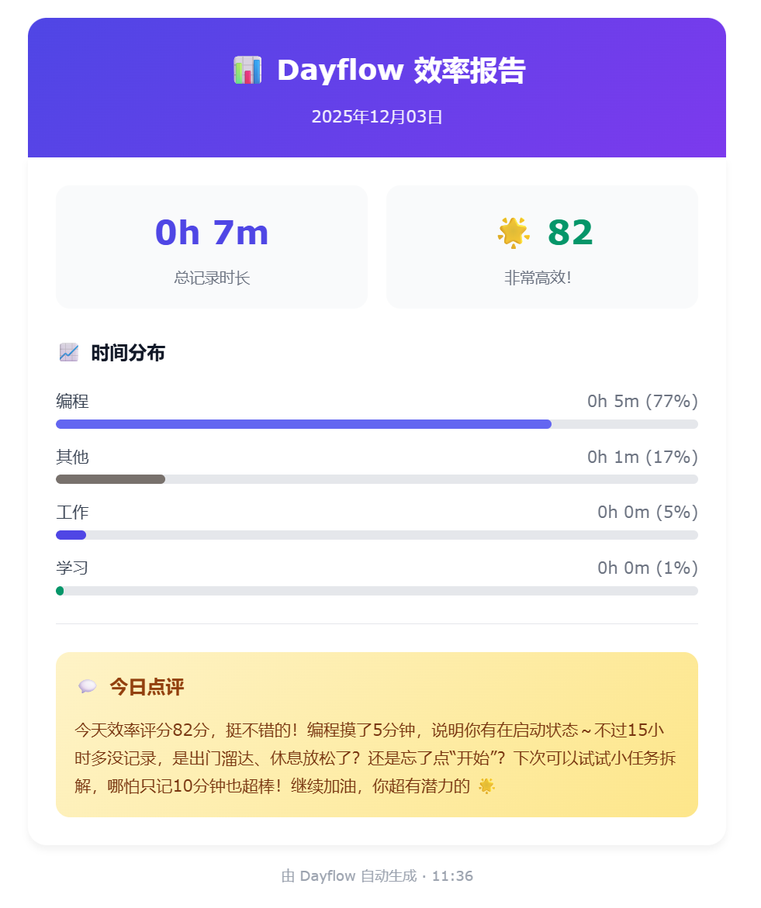

<div align="center">

# ⏱️ Dayflow for Windows

**AI-powered time tracking and productivity analysis for Windows**

[](https://python.org)
[](https://tauri.app/)
[](https://www.rust-lang.org/)
[](LICENSE)
[](https://www.microsoft.com/windows)

*Silent background recording → AI analysis → visual timeline*

[](https://github.com/SeiShonagon520/Dayflow/releases)

[中文](README.md) | **English**

</div>

---

## 🎯 What is Dayflow?

**Dayflow** is an AI-powered time tracking tool for Windows. It quietly captures low-frequency screen activity and window context in the background, uses a vision model to infer what you are doing, and turns the result into a timeline, statistics dashboard, and reports so you can understand where your time actually goes.

### 💡 Who is it for?

- People who want to know where their day went
- People who want to review focus time, distractions, and work patterns
- People who need automatic activity logs, daily reports, or weekly summaries
- People who prefer passive tracking over manual timers

### 🏆 Key advantages

| Advantage | Description |
|-----------|-------------|
| **Zero effort** | Start it and let AI handle activity recognition automatically |
| **Low overhead** | 1 FPS recording + smart compression to keep background usage low |
| **Local first** | Raw recordings stay on your machine and temporary chunks are cleaned up after analysis |
| **Smart categories** | Automatically detects work / study / entertainment / social / rest |
| **Visual review** | Timeline, statistics page, and HTML dashboard for different review styles |

---

## 🔐 Privacy, upfront

Dayflow is designed around **local recording + cloud analysis + local storage**.

### 5 things you should know

1. **Full videos are not uploaded**  
   Raw recording chunks stay on your local machine.

2. **Only a limited number of keyframes are sent for analysis**  
   The current README describes up to 8 extracted frames per chunk being sent to the configured vision model.

3. **Analysis results are stored locally**  
   Activities, settings, and statistics are saved in a local SQLite database.

4. **Temporary chunks are cleaned up automatically**  
   After analysis, temporary recording files are deleted to reduce disk usage.

5. **You can pause recording for sensitive moments**  
   Passwords, banking, private chats, or anything else sensitive can be handled by pausing recording first.

### Local data location

```text
%LOCALAPPDATA%\Dayflow\
├── dayflow.db      # activities, settings, stats
├── dayflow.log     # runtime logs
├── chunks\         # temporary recording chunks
└── updates\        # downloaded updates
```

> 💡 If privacy is your first concern, read this section before enabling continuous recording.

---

## ✨ Main features

| Feature | Description |
|---------|-------------|
| 🎥 **Low-power recording** | 1 FPS low-resource background capture |
| 🪟 **Window tracking** | Uses Windows API to capture real app names and window titles |
| 🤖 **AI analysis** | Vision LLM classifies screen activity automatically |
| 📊 **Timeline view** | Clear daily activity review at a glance |
| 📈 **Statistics dashboard** | Time distribution, productivity trends, week comparison |
| 📊 **Web dashboard export** | Beautiful self-contained HTML report with charts |
| 📧 **Email reports** | Automatic daily summaries and deeper analysis |
| 🔄 **Auto update** | Check, download, and install new versions |
| 🚀 **Auto start** | Launch on boot and minimize to tray |
| 📥 **CSV export** | Export activity data for further analysis |
| ⏸️ **Pause recording** | Pause when handling sensitive content |
| 🎨 **Theme switching** | Dark / light themes with saved preferences |

### 🆕 Recent highlights

#### v1.6.0 (2026-10)

- **Major Architectural Overhaul**: Completely migrated from desktop Qt to **Tauri 2.0 (Rust) + React 18 + Vite**, delivering instant startup, fluid animations, and significantly lighter resource footprint.
- **Modern Responsive UI**: Three-pane responsive layout, rich activity timeline cards, smooth interactive charts, and system dark theme support.
- **Kernel-level Process Management (Windows Job Object)**: Embedded Python bridge process tree is bound to Windows Job Object, eliminating console windows and orphan processes.
- **Offline Resilient Report Generation**: When external AI APIs time out or fail (e.g. invalid/expired key), automatic local aggregation synthesizes a structured Markdown daily report in milliseconds.
- **Interactive Statistics Dashboard**: 7-day and 30-day metrics, productivity trend chart, category donut breakdown, daily activity heatmap, and hourly distribution graph.
- **Multi-Monitor & Idle Pause**: Panoramic multi-screen capture and automatic pause/resume based on keyboard and mouse idle detection.
- **Privacy Filtering**: Window title & process blacklist filtering, plus storage quota limits with automatic cleanup.

- Statistics page redesign with metric cards, donut chart, trend chart, heatmap, and week comparison
- Activity cards can now be edited or deleted
- Better visual polish across the UI

#### v1.5.0 (2025-12)

- Windows API window tracking for more accurate recognition
- UI refresh: efficiency indicator bar, deep work badge, live recording duration, and more
- Improved prompting and data processing logic

---

## 🖥️ Screenshots

### Timeline page



*Daily activity cards with time range, app, summary, and productivity score.*

### Statistics page



*Dashboard-style overview with key metrics, distribution charts, heatmap, and comparisons.*

### Web dashboard

#### Date selection


#### HTML report


*Exported HTML dashboard that can be opened in a browser and shared directly.*

### Email reports

#### Settings



#### Examples

<div align="center">


</div>

#### Deep analysis


### Auto update / auto start


---

## ✅ README checklist covered in this revision

- [x] Removed garbled text, typos, and broken directory names
- [x] Reframed the opening so the project value is clearer
- [x] Moved privacy information near the top
- [x] Reduced feature overload and tightened the structure
- [x] Added a roadmap section
- [x] Added known limitations
- [x] Clarified the current license choice
- [x] Aligned the English README with the Chinese version
- [x] Added a minimal Windows CI workflow

---

## 🚀 Quick start

### Requirements

- Windows 10 / 11 (64-bit)
- Python 3.10+
- [FFmpeg](https://ffmpeg.org/download.html) added to PATH

### Installation

```bash
git clone https://github.com/SeiShonagon520/Dayflow.git
cd Dayflow

conda create -n dayflow python=3.11 -y
conda activate dayflow

pip install -r requirements.txt
python main.py
```

### Build as EXE (optional)

```bash
pip install pyinstaller
python build.py
```

Or simply double-click `build.bat`.

### Download prebuilt releases

If you just want to use Dayflow without setting up Python locally:

1. Open [Releases](https://github.com/SeiShonagon520/Dayflow/releases)
2. Download the latest installer or archive
3. Extract it and run `Dayflow.exe`

> 💡 For the first run, configure the API first and then start recording.

---

## 📖 Basic usage

### 1. Configure your API

Go to **Settings** and fill in:
- **API URL**: any OpenAI-compatible endpoint
- **API Key**
- **Model name**: a vision-capable model

Then click **Test Connection** and **Save Config**.

### 2. Start recording

- Click **Start Recording**
- The app records at 1 FPS in the background
- A video chunk is generated every 60 seconds
- Keyframes are sent to your configured model service for analysis

### 3. Review your timeline

Each card shows a time range, category, app, summary, and productivity score.

### 4. Optional features

- **Email reports**: scheduled summaries and deeper analysis
- **Auto start**: launch with Windows and minimize to tray
- **Auto update**: check and install new versions
- **System tray**: control recording without keeping the main window open

---

## 📁 Project structure

```text
Dayflow/
├── main.py
├── config.py
├── requirements.txt
├── build.py
├── build.bat
├── updater.py
│
├── core/
│   ├── types.py
│   ├── recorder.py
│   ├── window_tracker.py
│   ├── llm_provider.py
│   ├── analysis.py
│   ├── email_service.py
│   ├── updater.py
│   ├── autostart.py
│   ├── config_manager.py
│   ├── log_manager.py
│   ├── stats_collector.py
│   └── dashboard_exporter.py
│
├── database/
│   ├── schema.sql
│   ├── storage.py
│   └── connection_pool.py
│
├── ui/
│   ├── main_window.py
│   ├── timeline_view.py
│   ├── stats_view.py
│   ├── date_range_dialog.py
│   └── themes.py
│
├── templates/
│   └── dashboard.html
│
└── assets/
    └── icon.ico
```

---

## ⚙️ Configuration

| Variable | Description | Default |
|----------|-------------|---------|
| `DAYFLOW_API_URL` | API endpoint | `https://apis.iflow.cn/v1` |
| `DAYFLOW_API_KEY` | API key | (empty) |
| `DAYFLOW_API_MODEL` | AI model | `qwen3-vl-plus` |

---

## 🛠️ Tech stack

| Component | Technology |
|-----------|------------|
| GUI | PySide6 (Qt6) |
| Screen capture | dxcam (DirectX) |
| Video processing | OpenCV |
| HTTP client | httpx (HTTP/2) |
| Database | SQLite |
| AI analysis | OpenAI-compatible APIs |

---

## 🗺️ Roadmap

### Near term

- [ ] More explicit privacy controls and recording safeguards
- [ ] Smarter activity merging and cleaner timeline segmentation
- [ ] Richer statistics and trend analysis
- [ ] More reliable update and installation flow
- [ ] Better automated testing and CI coverage

### Mid term

- [ ] Multi-monitor support
- [ ] Better website / app recognition
- [ ] Local-model or hybrid analysis mode
- [ ] Smarter daily / weekly behavioral insights
- [ ] More complete export and reporting options

---

## Known limitations

- Windows 10 / 11 only
- Recognition quality depends on the vision model you configure
- Some apps may not expose stable window titles
- Full-screen games, special rendering windows, and remote desktop scenarios may behave differently
- Multi-monitor support still has room for improvement
- Analysis latency depends on your network and model provider stability

---

## 🧰 Troubleshooting

### 1. No analysis results appear

Check the following first:
- API URL, key, and model name are correct
- The configured model supports vision input
- Your network can reach the model provider
- The log contains no timeout or request errors

### 2. Screen capture or window tracking looks wrong

Check the following first:
- You are running on Windows 10 / 11
- FFmpeg is installed and available in PATH
- Security software is not blocking capture or window inspection
- You are not in a special case such as full-screen games, remote desktop, or unusual rendering modes

### 3. Email reports fail to send

Check the following first:
- QQ Mail SMTP / authorization code is correct
- The built-in test send works
- Your local network is not blocking the mail service

### 4. Updates or auto-start do not work

Check the following first:
- You are running the packaged EXE build
- The EXE path has not changed unexpectedly
- System permissions or security policy are not blocking startup/update behavior

---

## 💡 Inspiration

This project is inspired by [Dayflow (macOS)](https://github.com/JerryZLiu/Dayflow). The original project is macOS-only, so this repository brings a similar idea to Windows users.

Thanks to the original author for the creativity and open-source spirit.

---

## 📄 License

[CC BY-NC-SA 4.0](LICENSE) © 2024-2025

This project currently uses **Creative Commons Attribution-NonCommercial-ShareAlike 4.0**.
- ✅ You can learn from it, modify it, and share it
- ✅ Please credit the original author
- ❌ Commercial use is not allowed

> ℹ️ This is not a typical software license such as MIT or Apache-2.0. If you plan to redistribute or use the project commercially, read `LICENSE` carefully first.

---

## ⭐ Star History

<a href="https://star-history.com/#SeiShonagon520/Dayflow&Date">
 <picture>
   <source media="(prefers-color-scheme: dark)" srcset="https://api.star-history.com/svg?repos=SeiShonagon520/Dayflow&type=Date&theme=dark" />
   <source media="(prefers-color-scheme: light)" srcset="https://api.star-history.com/svg?repos=SeiShonagon520/Dayflow&type=Date" />
   
 </picture>
</a>

---

<div align="center">

**If you find Dayflow useful, consider giving it a ⭐ Star!**

</div>
